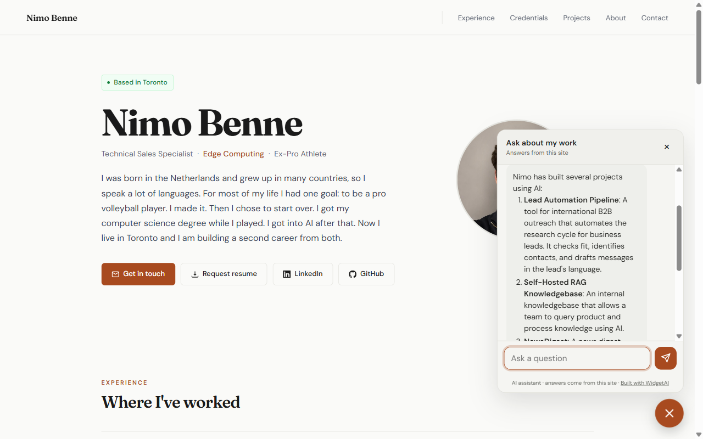

# WidgetAI

A small AI assistant that any website can add with one script tag. It answers visitor questions using only that site's own content, links to the section it used, and declines everything else.

**Live:** [nimobenne.github.io](https://nimobenne.github.io) (chat button, bottom right) · [product page](https://chat-bot-widget-two.vercel.app)



## What it does

- **Grounded answers.** Each site has a snapshot of its public pages. The assistant answers only from that snapshot and cites the section it used. Questions it cannot answer get a plain "not covered" reply with a link to the site's contact section.
- **One embed, many sites.** Each site has its own config: allowed domains, greeting, starter questions and content. Requests carry signed tokens bound to the site and domain, so a copied script tag does not work elsewhere.
- **Hard cost caps.** Built to cost a few cents a day:
  1. a dedicated OpenAI project with prepaid credit and auto-recharge off,
  2. a kill switch,
  3. per-visitor limits (5 per minute, 30 per day) and 20 messages per chat,
  4. daily and monthly global caps,
  5. short answers, a small model, no retries.
  All limits are reserved in Postgres before any model call, and every check fails closed.
- **Private by design.** No IP addresses are stored (salted hashes only for rate limits). Questions are kept for 30 days without any visitor identity so answers can be improved.
- **Fits the host site.** The widget is dependency-free and runs in a Shadow DOM. It inherits the host's font, takes the accent colour from a data attribute, follows light and dark mode, and works with the keyboard and at phone width.
- **Stays current.** A weekly GitHub Action re-syncs the site snapshot and the owner's public GitHub projects.

## How it is built

| Part | Choice |
| --- | --- |
| App and APIs | Next.js (App Router), TypeScript, on Vercel |
| Answers | OpenAI Chat Completions (`gpt-4o-mini`), no tools |
| Data | Neon Postgres: usage counters and a 30-day question log only |
| Widget | One plain JavaScript file, Shadow DOM, no dependencies |
| Quality | Node test runner (46 tests), CI on every push |

```
public/widget.js        the embeddable widget
app/api/chat            chat endpoint: validation, caps, answer
app/api/widget          config and signed-token endpoints
lib/limits.ts, store.ts cost caps and the Postgres store
lib/ai.ts               prompt, grounding and source checks
sites/<siteId>/         per-site config and content snapshot
```

Technical details, environment variables and setup: [mdfiles/README.md](mdfiles/README.md).

## Run it locally

```sh
npm install
npm test
npm run dev
```

Without `DATABASE_URL` it uses an in-memory store. Chat needs `OPENAI_API_KEY`, `WIDGET_SIGNING_SECRET`, `IP_SALT` and `CHAT_ENABLED=true` (see `.env.example`).

## About

Built by [Nimo Benne](https://nimobenne.github.io) as a portfolio project. It is added to sites on request; there is no self-service sign-up.
